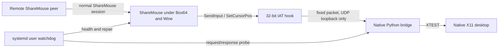

# Architecture

## Hook

The injector finds `sharemouse.exe` with Toolhelp, allocates the DLL path in that process, and starts `LoadLibraryA` with `CreateRemoteThread`. The DLL patches matching imports in the main executable's import address table.

The original Win32 API is still called, preserving ShareMouse's own state. A compact mirror packet is sent to `127.0.0.1:48655` for each relevant call.

## Native bridge

The Python bridge loads the host's X11 and XTEST libraries with `ctypes`. It maps Win32 virtual keys, scan codes, mouse flags, wheel data, and absolute/relative motion to XTEST events.

The UDP endpoint is loopback-only. It recognizes:

- a fixed magic and protocol version
- cursor, mouse, keyboard, and ready event kinds
- a private `SMXI_HEALTH` / `SMXI_OK` liveness probe

## Watchdog

The watchdog checks every 20 seconds by default and requires two consecutive failures before repair. It validates:

- exactly one `sharemouse.exe`
- a runnable process state
- no visible ShareMouse application-error dialog
- UDP 1046 and TCP 6555 listeners
- non-saturated discovery and connection-accept queues
- exactly one native bridge
- UDP 48655 bound to loopback
- active health-probe response
- hook mapping in `/proc/<pid>/maps`

A bridge-only failure triggers targeted bridge replacement. A ShareMouse/Wine failure triggers a clean Wine shutdown and full restart. Repairs have a cooldown to avoid restart storms.

## Why not decode the LAN protocol?

ShareMouse can already establish its own authenticated/encrypted peer session under Wine. Mirroring the local input API avoids handling credentials, encryption, clipboard content, or undocumented network framing and keeps interoperability narrowly scoped to native input delivery.
